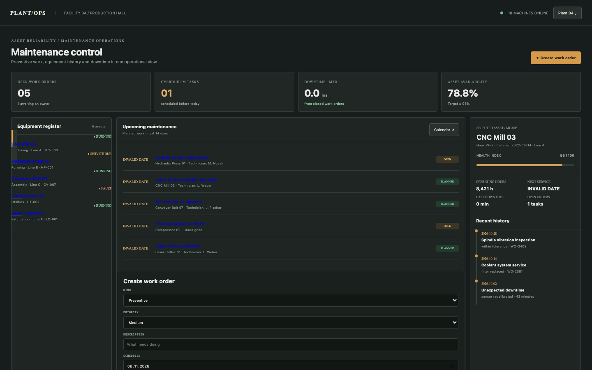

# Maintenance Log

An industrial maintenance control room: equipment register, preventive work orders, downtime, service history and close-out notes. It records machine states; it never controls machinery.

## Run it

```sh
npm install
npm start
```

Open the address it prints. `npm test` runs the tests (node:test; no network, no key).

## What to ask the chat next

- Create a repair work order for the compressor and assign it to M. Novak.
- Close the overdue hydraulic work order with a note and 30 minutes of downtime.
- Select the CNC mill and review its recent service history.

## Screenshot


